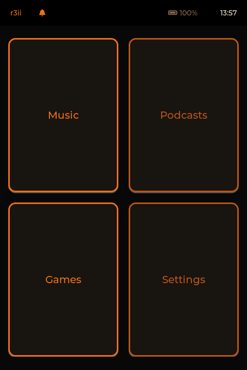
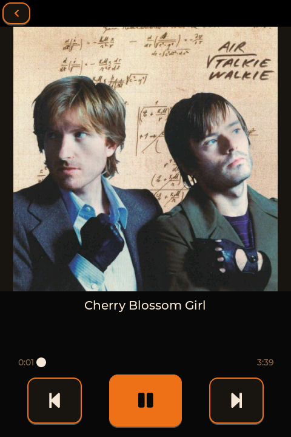
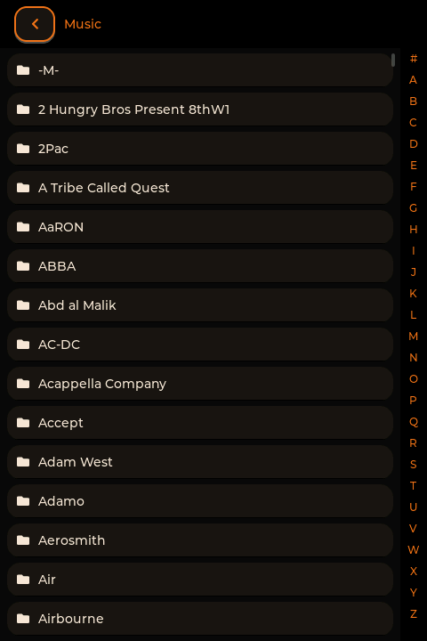
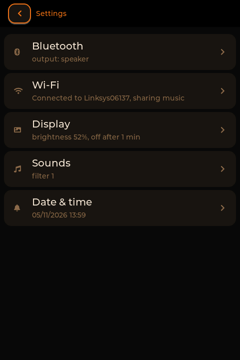
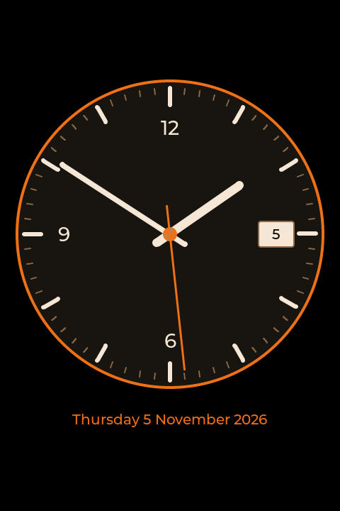
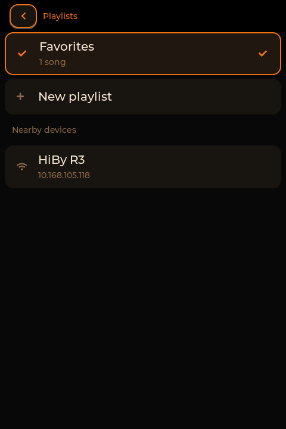
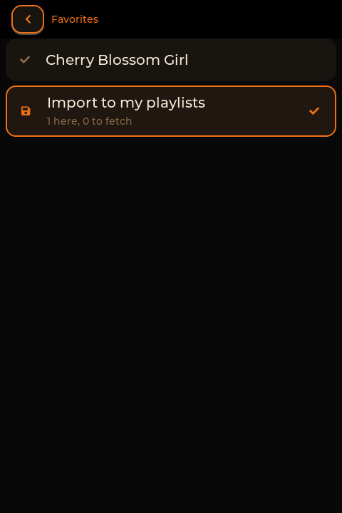
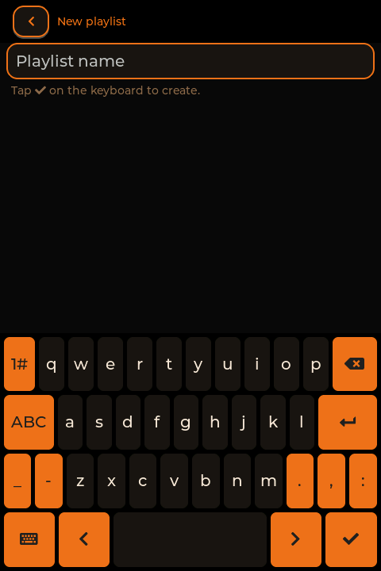

# r3ii-player

A fast, minimalist music-player firmware UI for the **HiBy R3 Pro II** DAP. It replaces
the stock `hiby_player` interface with a clean, touch- and button-driven player that boots
straight to your library, with Bluetooth, games and a music server built in.

Built from scratch in C on **LVGL**, running as static MIPS binaries directly on the
device's framebuffer. No HiBy code is included — the firmware interop was reverse-engineered
for this one model.

> ⚠️ **Experimental, use at your own risk.** This flashes a custom rootfs. It has only been
> tested on the **HiBy R3 Pro II** (reports `R3PROII 1.2`). Do **not** use it on the plain
> R3 II or other models. Flashing always carries a bricking risk — keep HiBy's official
> stock `.upt` so you can roll back (see [Rollback](#rollback)). The author is not
> responsible for damaged devices or lost data.

---

## Screenshots

| Home | Now Playing | Library (A–Z rail) |
|:---:|:---:|:---:|
|  |  |  |
| **Settings** | **Watch face (idle)** | |
|  |  | |
| **Playlists & nearby devices** | **Import a shared playlist** | **New playlist** |
|  |  |  |

---

## Features

**Player**
- Boots straight into the library — fast startup, smooth with large collections (600+ artists).
- Browse by your folder structure (**Artist → Album → Song**), with an **A–Z quick-scroll
  rail** on list screens.
- Now Playing with **full-width album art** (embedded cover art: ID3v2 APIC / FLAC PICTURE /
  MP4 cover), a **seekable progress bar**, play/pause, and **album auto-advance**.
- **Resume** the last track across power-off.
- Formats: **MP3, FLAC, WAV, M4A/AAC** (minimp3 / dr_flac / dr_wav / faad2+minimp4).
- Dark theme (black + orange), retro-styled home menu: **Music · Podcasts · Games · Settings**.
- **Podcasts** tab browses a separate `Others/` folder on the card.

**Controls**
- **Power button:** short press → Now Playing; press again → back; **long press → power off**
  (saves the current track to resume on next boot).
- **Touch lock:** press **Power + Volume** together (either volume key, either order) to lock
  the touchscreen — touches are ignored and can't wake the screen, so it's safe in a pocket,
  while the hardware keys keep working. A padlock shows in the corner; the same combo unlocks.
- **Volume rocker:** changes volume with a top overlay; **◀◀ / ▶❚❚ / ▶▶** hardware keys for
  previous / play-pause / next (plus on-screen transport).

**Bluetooth**
- **Output** to BT speakers/headphones (A2DP source), remembers multiple devices, easy switching.
- **Receiver** mode (A2DP sink): stream from an iPhone/iPod into the R3 and out the jack.
- **Game controllers** over Bluetooth (Joy-Con, Pro Controller, DS4, 8BitDo…) via UserspaceHID;
  a paired controller auto-reconnects when you press a button.
- Battery of connected BT devices shown in the status bar / settings.

**Playlists & favorites**
- One-tap **♥ favorite** on Now Playing, plus user **playlists** created with an on-screen keyboard.
- Stored as portable **extended `.m3u`** files in `Playlists/` on the card (edit them on a PC too).
- **Share over the LAN:** nearby R3s are discovered automatically; browse another device's
  playlists and **import** one — songs you already have resolve locally, and the ones you're
  missing are copied from the peer **after you confirm**.

**Explorer** (Home tile)
- Dig through the library by **main genre › subgenre** (Metal › Power metal, Rock › Grunge…), or
  **Surprise me**. The player picks a random artist, preferring the ones you rarely play, and
  shows its card: **Listen to this album** (least-played first), **Another album**, **Similar
  artist** (same subgenre, then same genre, close in era), **Different artist**, and **Keep**
  (adds the album to a `Discovered` playlist).
- **Explorer radio:** when an album started from Explorer ends, an album by a similar artist
  follows. **Double-press ▶▶** to jump to it right away; the orange button on Now Playing
  returns to the artist card.
- Genres come from the files' tags, cleaned up (`Punkrock` = `Punk Rock`, `métal`, `B.O.`…);
  each artist gets the genre most of its tracks have. Fix or complete them in `Genres.txt`
  at the root of the card:
  ```
  Rammstein = Metal > Industrial metal          # main genre > subgenre
  Ghost = heavy metal; doom metal               # or tag values
  genre: neue deutsche härte = industrial metal # a spelling, for every artist
  ```
  For artists with no usable tags, `python3 scripts/genres_mb.py --sd <card>` (or `--adb`)
  fetches their genres from MusicBrainz into a `[musicbrainz]` section of that file.

**Wi-Fi & music server**
- Wi-Fi settings; **r3srv**, a UPnP/DLNA + HTTP server that serves your library (incl. album art)
  over the network.
- **Browse the collection** from VLC (Local Network > Universal Plug'n'Play) or a web browser
  (`http://<R3 address>:8200/`): by folder, **Artists A–Z**, **Albums A–Z** (with covers) and
  **Recently added**; every folder has an m3u link for VLC.
- **R3 radio for VLC:** an endless mix from the library, Explorer-style (an album, then a
  similar artist's album…), streamed straight from the card in original quality. Open
  `http://<R3 address>:8200/radio` for the genres and subgenres, or paste a link like
  `http://<R3 address>:8200/radio.m3u?genre=Metal&sub=Power%20metal` in VLC (Media > Open
  Network Stream). Also under VLC's Local Network > Universal Plug'n'Play > R3 Radio.

**Languages**
- **English** and **Français** (Settings → Language); accents and non-ASCII names display
  properly (Montserrat with a TTF fallback for Latin, Cyrillic, Vietnamese).
- **Chinese / Japanese / Korean** names: put a TrueType font in `Fonts/` on the card (e.g.
  `DroidSansFallbackFull.ttf`, Apache-2.0); it is memory-mapped, not loaded into RAM.
- Lists sort ignoring accents (Édith Piaf sits with the E's).
- Translations are plain gettext `.po` files in `lang/` — adding a language is one file:
  see [docs/TRANSLATING.md](docs/TRANSLATING.md).

**Games** (bring your own data files)
- **Doom** (`doomgeneric`) — supply your own `doom.wad` / `doom2.wad`.
- **Blockfall** (Tetris-style), **Brickstorm** (breakout), **Coil** (snake-style),
  **Sapper** (minesweeper-style), all from scratch.
- **Drumfolk**, a rhythm-marching battle game: drum commands on the beat (or the beat of your
  own songs) to lead a squad through 12 missions on a world map, two acts and six lands.
  Gear beats foes (crush cracks armour, fire burns wood, only ranged hits flyers…), bosses
  telegraph their blows, and in fever the squad dances on the beat. Rescue missions free caged
  prisoners: they fight with you on the spot and win a soldier slot for good (squad of 4 → 8);
  each mission sets how many march.
- **Game Boy** emulator (`Peanut-GB`) — supply your own ROMs.
- **Game Boy Advance** emulator (`gpSP` with its MIPS dynarec, full speed) — your own ROMs in
  `Games/GBA`, optional `gba_bios.bin`; landscape with a controller, save + resume on quit.
- Portrait on-screen controls + full Bluetooth-controller support; per-game **high scores**.

---

## Hardware target

| | |
|---|---|
| Device | HiBy **R3 Pro II** (`R3PROII 1.2`) |
| SoC | Ingenic **X1600** (XBurst2, MIPS32r2, O32 **hard-float**, little-endian, has FPU) |
| Kernel | Linux 4.4.94+ · Buildroot 2020.02 |
| Display | `/dev/fb0` 480×720 RGB565 · Goodix touch (`event1`) |
| Audio | dual CS43198 DAC via ALSA/tinyalsa (card0) |
| Writable area | `/usr/data` (ubifs) — survives a rootfs flash |
| SD card | mounts at `/usr/data/mnt/sd_0` (vfat) |

Binaries are **fully static** (musl `mipsel-linux-musl`), so the device's glibc version is
irrelevant. Full probed profile: [`docs/DEVICE_R3PROII.md`](docs/DEVICE_R3PROII.md).

---

## Card layout

Put your content on the microSD like this:

```
/Music/<Artist>/<Album>/<NN. Title>.<mp3|flac|wav|m4a>
/Others/<Show>/<episode>.<mp3|m4a|…>     # Podcasts tab
/Games/Doom/{doom.wad,doom2.wad}         # your WADs
/Games/GameBoy/*.gb                      # your Game Boy ROMs
/Games/GBA/*.gba                         # your GBA ROMs (+ optional gba_bios.bin)
/Fonts/*.ttf                             # optional: font for CJK names
```

Album art is read from the audio files' embedded tags (no separate cover files needed).

---

## Build

Requires the musl cross-toolchain at `toolchain/mipsel-linux-musl-cross/` (not committed —
download a `mipsel-linux-musl-cross` build, e.g. from musl.cc, and extract it there). Then:

```sh
sh scripts/build.sh        # the player UI + audio  -> build/r3player
sh scripts/build_doom.sh   # Doom                   -> build/r3doom
sh scripts/build_gb.sh     # Game Boy               -> build/r3gb
sh scripts/build_gba.sh    # Game Boy Advance       -> build/r3gba
sh scripts/build_srv.sh    # music server           -> build/r3srv
```

No make/cmake needed. All third-party code is vendored under `vendor/`.

---

## Install (persistent)

The player installs as a custom rootfs that runs `/usr/data/r3player` in a loop (falling back
to stock if it's missing). Because it lives on the writable `/usr/data`, you can update it
afterwards over ADB **without reflashing**.

1. Build the `.upt`:
   ```sh
   sh scripts/build_upt.sh <rootfs.squashfs> <kernel.img> r3proii.upt
   ```
   The squashfs is a dump of the device's own rootfs (mtd2), modified so
   `/usr/bin/hiby_player.sh` launches `r3player`. See [`docs/PERSIST.md`](docs/PERSIST.md) for
   the exact rootfs modifications and the `.upt` format.
2. Copy `r3proii.upt` to the **root of the SD card**.
3. Power off, then **hold Vol-Up and press Power** to enter the recovery updater; wait for
   success and reboot.

**Validate with a rebuilt-stock image first** (same steps) to confirm the `.upt` format boots
on your unit before flashing the modified one.

### Fast updates (no reflash)

Once installed, ADB stays enabled at boot:

```sh
adb push build/r3player /usr/data/r3player
adb shell 'kill -9 $(pidof r3player)'   # the launcher restarts it
```

---

## Rollback

Flash HiBy's **official stock `.upt`** the same way (SD root + Vol-Up+Power). The recovery
slot (B) is left intact, so a stock restore is always available.

---

## Repo layout

```
src/ui/      player UI (main, audio, bt, pad, cover, games, settings…)
src/doom/    Doom backend        src/gb/   Game Boy frontend
src/net/     r3srv music server  src/bringup/ dev/bring-up helpers
scripts/     build.sh + per-component build scripts + build_upt.sh
device/      modified launcher (hiby_player.sh)
docs/        DEVICE_R3PROII.md (hardware), PERSIST.md (install), PLAN.md
vendor/      third-party libraries (see Credits)
```

---

## Credits / licenses

This project bundles the following open-source libraries under `vendor/` (each keeps its own
license):

- [LVGL](https://lvgl.io/) — UI toolkit (MIT), incl. tiny_ttf / stb_truetype and the
  Montserrat font it ships (SIL Open Font License)
- [minimp3](https://github.com/lieff/minimp3), [dr_libs](https://github.com/mackron/dr_libs)
  (dr_flac/dr_wav), [stb_image](https://github.com/nothings/stb) — decoders (public domain / MIT)
- [faad2](https://github.com/knik0/faad2) + [minimp4](https://github.com/lieff/minimp4) —
  AAC/M4A (GPL / CC0)
- [tinyalsa](https://github.com/tinyalsa/tinyalsa) — ALSA (BSD)
- [doomgeneric](https://github.com/ozkl/doomgeneric) — Doom port (GPLv2)
- [Peanut-GB](https://github.com/deltabeard/Peanut-GB) + minigb_apu — Game Boy (MIT)
- [gpSP](https://github.com/libretro/gpsp) (libretro) — Game Boy Advance (GPLv2), see `vendor/gpsp/R3_PATCHES.md`

No HiBy firmware, Doom WADs, or game ROMs are included — bring your own data files.
Reverse-engineered purely for interoperability on hardware you own.

---

## License

r3ii-player is free software, released under the **GNU General Public License, version 2**
(see [`LICENSE`](LICENSE)) — you are free to use, study, modify and redistribute it under the
GPL's terms. Copyright © 2026 Théodore Chabardès.

The bundled third-party libraries (listed above) keep their own, GPL-compatible licenses. GPLv2
is used for the project as a whole because it links GPLv2 components (faad2, doomgeneric).
